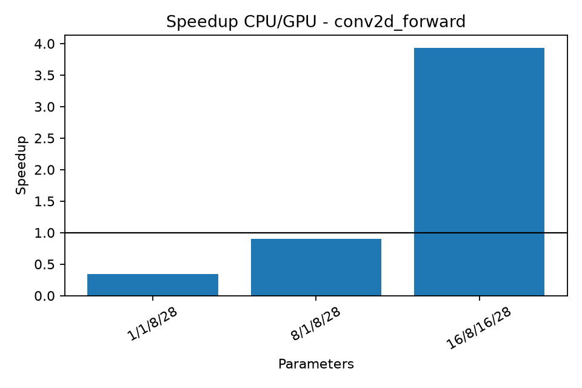
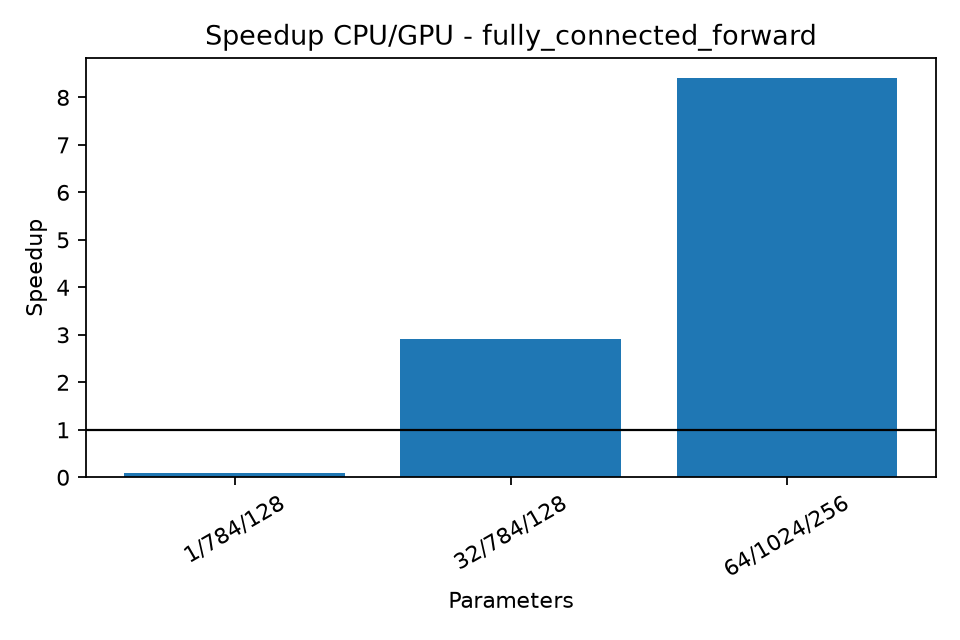
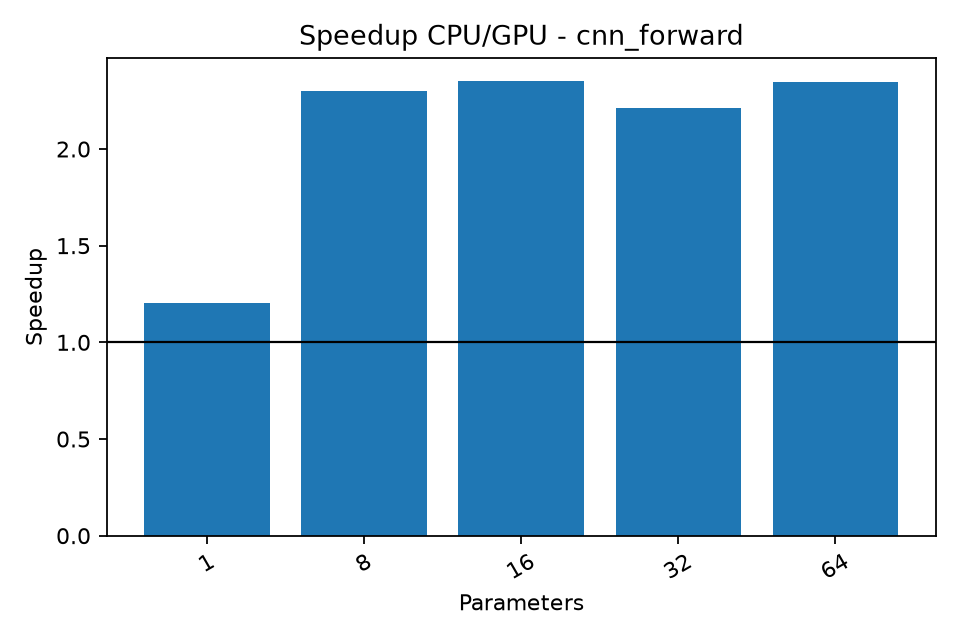
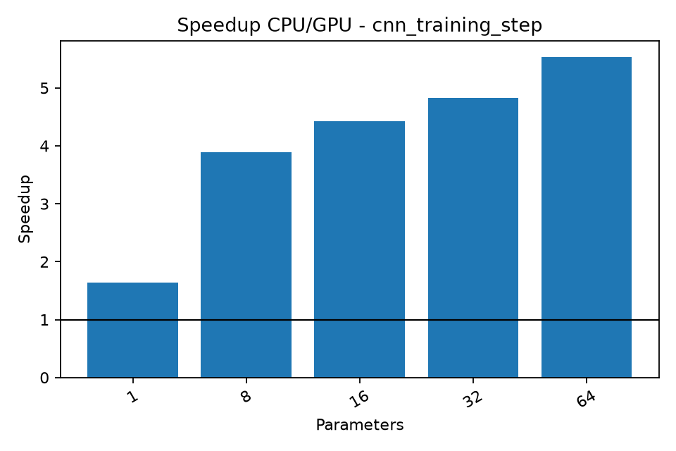
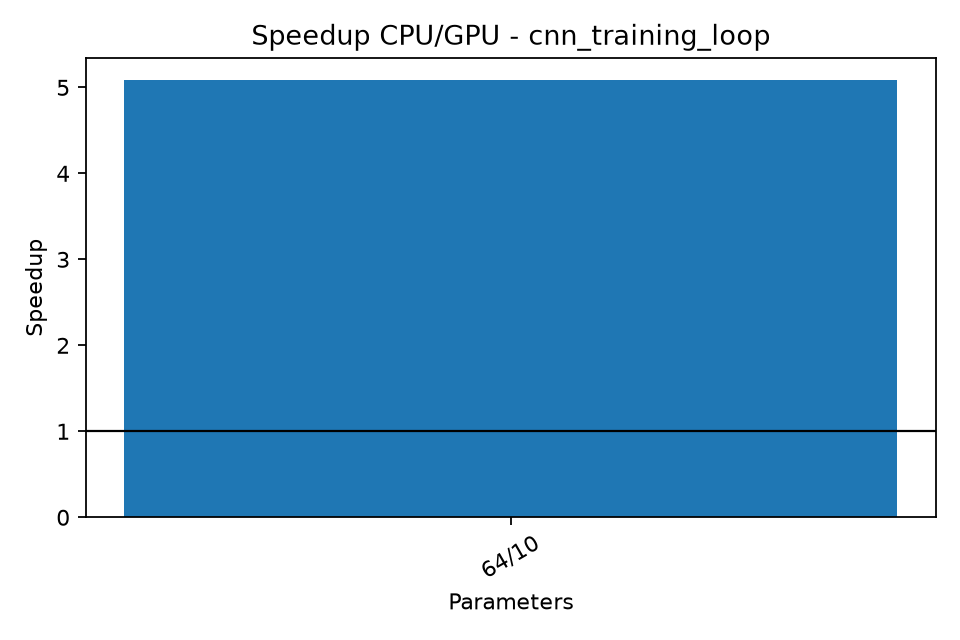
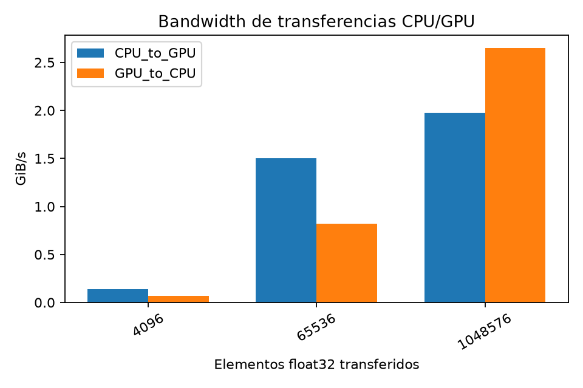

# Interpretacion de graficas de benchmarks

Este documento interpreta las graficas generadas por:

```powershell
scripts\.venv\Scripts\python.exe scripts\analyze_benchmarks.py benchmarks\results.json --out-dir benchmarks\results\processed
```

Las graficas viven en:

```text
benchmarks/results/processed/figures/
```

La metrica principal de las graficas de speedup es:

```text
speedup_cpu_over_gpu = tiempo_CPU / tiempo_GPU
```

Por lo tanto:

- `speedup > 1`: GPU fue mas rapido que CPU.
- `speedup = 1`: CPU y GPU tardaron aproximadamente lo mismo.
- `speedup < 1`: CPU fue mas rapido que GPU.

Los valores interpretados aqui corresponden a `benchmarks/results/processed/speedups_cpu_gpu.csv` y `benchmarks/results/processed/transfer_bandwidth.csv`.

La CNN usada en los benchmarks de red completa corresponde a la arquitectura de `project/app.cpp`.

## `tensor_add_speedup.png`


Esta grafica compara una suma elemento a elemento en tensores de 4096, 65536 y 1048576 elementos.

Resultados observados:

```text
4096 elementos:    speedup 0.016
65536 elementos:   speedup 0.105
1048576 elementos: speedup 0.306
```

La CPU gana en todos los tamanos medidos. Es esperable para una operacion muy simple y con poca intensidad aritmetica. El costo fijo de lanzar un kernel CUDA y sincronizar domina frente a una sola suma por elemento.

Aunque el speedup mejora con el tamano, todavia no supera `1`. Para que este tipo de operacion favorezca a GPU, harian falta tensores mayores, fusion de kernels o menor frecuencia de sincronizacion.

## `matmul_speedup.png`


Esta grafica compara multiplicacion de matrices cuadradas:

```text
64x64:   speedup 0.484
128x128: speedup 1.837
256x256: speedup 4.354
```

La GPU pierde en `64x64`, pero gana desde `128x128` y mejora claramente en `256x256`. Esta es una de las graficas mas utiles para el paper porque muestra el punto donde el paralelismo de GPU empieza a compensar el overhead.

## `conv2d_forward_speedup.png`



Esta grafica compara el forward de una capa convolucional:

```text
batch=1,  C_in=1, C_out=8,  H=28: speedup 0.385
batch=8,  C_in=1, C_out=8,  H=28: speedup 0.861
batch=16, C_in=8, C_out=16, H=28: speedup 3.735
```

La CPU gana para el caso pequeno y queda casi empatada en batch 8. En el caso mas grande, la GPU gana con claridad.

Esto indica que la convolucion via `im2col + matmul` necesita suficiente trabajo acumulado para amortizar conversiones, lanzamientos de kernels y sincronizaciones. La grafica justifica variar batch size y dimensiones en lugar de reportar un unico caso.

## `fully_connected_forward_speedup.png`



Esta grafica compara el forward de capas densas:

```text
batch=1,  784->128:  speedup 0.096
batch=32, 784->128:  speedup 2.859
batch=64, 1024->256: speedup 8.193
```

Con batch 1, CPU es mucho mas rapida. Con batch 32 y batch 64, GPU gana con fuerza. Esto es coherente con la naturaleza de las capas densas: son multiplicaciones de matrices, y la GPU mejora cuando el problema tiene suficiente tamano.

## `cnn_forward_speedup.png`



Esta grafica mide el forward completo de la CNN tipo MNIST usada por `project/app.cpp`:

```text
batch=1:  speedup 0.986
batch=8:  speedup 2.025
batch=16: speedup 2.127
batch=32: speedup 2.430
batch=64: speedup 2.680
```

La GPU queda practicamente empatada en batch 1 y gana desde batch 8. El beneficio aumenta con el batch size y llega a `2.68x` en batch 64.

Este resultado es mas representativo para inferencia que las capas aisladas, porque combina convolucion, activacion, pooling, flatten, capas densas y softmax.

## `cnn_training_step_speedup.png`



Esta grafica mide una iteracion completa de entrenamiento:

```text
forward + backward + update_weights
```

Resultados observados:

```text
batch=1:  speedup 1.393
batch=8:  speedup 3.949
batch=16: speedup 4.452
batch=32: speedup 4.593
batch=64: speedup 4.778
```

La GPU gana en todos los casos, especialmente desde batch 8. El beneficio es mayor que en `cnn_forward` porque el paso de entrenamiento contiene mas trabajo computacional: backward, calculo de gradientes y actualizacion de pesos.

Este benchmark usa 16 batches sinteticos precreados fuera del bucle medido y avanza entre ellos durante las iteraciones. Por eso mide el costo computacional del paso de entrenamiento sin incluir lectura de dataset.

## `cnn_training_loop_speedup.png`



Esta grafica mide un loop de entrenamiento mas parecido al bucle interno de `project/app.cpp`, avanzando entre batches sinteticos:

```text
batch=64, training_steps=10: speedup 4.952
```

Este caso reduce la dependencia de un unico paso aislado y permite observar un tramo de entrenamiento sostenido. La GPU mantiene una ventaja clara, procesando alrededor de `410.8` muestras por segundo frente a `84.9` en CPU para este caso.

## `tensor_transfer_bandwidth.png`



Esta grafica mide ancho de banda efectivo de transferencia entre CPU y GPU.

Resultados observados:

```text
CPU -> GPU, 4096 elementos:    0.111 GiB/s
CPU -> GPU, 65536 elementos:   1.271 GiB/s
CPU -> GPU, 1048576 elementos: 2.178 GiB/s

GPU -> CPU, 4096 elementos:    0.072 GiB/s
GPU -> CPU, 65536 elementos:   0.818 GiB/s
GPU -> CPU, 1048576 elementos: 2.454 GiB/s
```

Las transferencias pequenas tienen bajo bandwidth efectivo porque el overhead fijo pesa mucho. En tamanos mayores el throughput mejora. Esta grafica sirve para explicar por que conviene separar benchmarks compute-only de benchmarks end-to-end con transferencia.

## Lectura general

Los resultados muestran un patron consistente:

- GPU pierde o empata en problemas pequenos y muy simples.
- GPU mejora al aumentar batch size, canales, dimensiones o cantidad de operaciones.
- Las operaciones elementwise simples no justifican por si solas el uso de GPU en estos tamanos.
- Las operaciones tipo matriz, convolucion y entrenamiento completo son las que mas se benefician.
- Las transferencias CPU/GPU tienen overhead visible, especialmente en tamanos pequenos.
- Los benchmarks de entrenamiento usan batches sinteticos precreados para evitar ruido de dataset.
- El benchmark de loop con 10 pasos se aproxima mejor al bucle interno de entrenamiento de `project/app.cpp`.

## Precauciones

Estas graficas no deben interpretarse como rendimiento final absoluto del proyecto. Son una foto de una configuracion concreta:

- build `Release`;
- una maquina especifica;
- datos sinteticos para los benchmarks de red;
- red completa usada por `project/app.cpp`;
- medicion compute-only para operaciones y CNN;
- medicion separada para transferencias CPU/GPU;
- sincronizaciones internas despues de kernels CUDA;
- implementaciones actuales de CPU y GPU.

Para resultados de paper, conviene reportar tambien:

- numero de repeticiones;
- `--benchmark_min_time` usado;
- media o mediana usada;
- hardware CPU/GPU;
- compilador y version de CUDA;
- si el benchmark incluye o excluye transferencias CPU/GPU;
- batch sizes y formas exactas.
